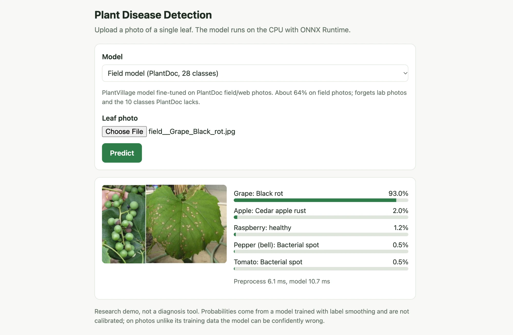
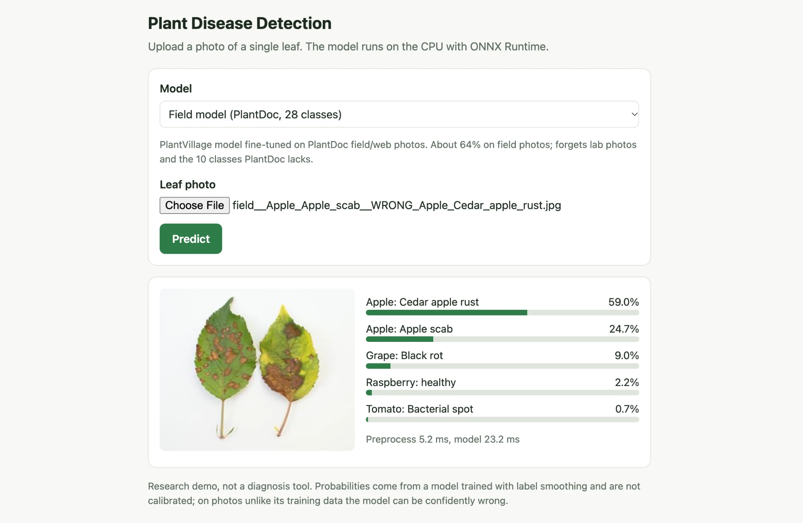
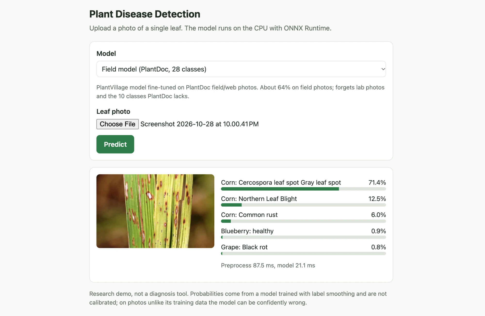

# Plant Disease Detection: from lab photos to real fields and to Bangladeshi rice

**Status: complete (v1.0).** Every number below is produced by a script in
this repository; models are on the
[v1.0 release](https://github.com/moshiurdev/Plant-Disease-Detection/releases/tag/v1.0).

Plant disease classifiers often score close to 100% on PlantVillage, but those
photos are single leaves on a plain background in a lab. Farmers take photos in
the field: cluttered backgrounds, several leaves, shadows, blur. This project
measures how much accuracy is lost when a model trained on lab photos meets
field photos, tries simple ways to close that gap, and asks whether what the
model learned helps on a crop it has never seen (rice from Bangladesh) when
only a few labelled photos are available.

## Main findings

1. **Lab → field: 0.997 → 0.309.** An EfficientNet-B0 that is near perfect on
   PlantVillage lab photos gets 31% on PlantDoc field/web photos of the same
   classes. Background clutter is not the main cause: clean leaves on white
   are about as hard as real scenes.
2. **Field photos fix more than augmentation.** Much stronger appearance
   augmentation made field accuracy slightly *worse* (0.284). Fine-tuning on
   5 PlantDoc photos per class lifts it to 0.47, and on all 1,822 to 0.65.
   Starting from the PlantVillage model beats ImageNet at every amount of
   field data. The fine-tuned model forgets lab photos (0.997 → 0.546).
3. **PlantVillage → rice: little transfer.** On Bangladeshi rice, a
   PlantVillage start beats ImageNet only with 10 labelled photos per class
   (+0.03), and not from 25 on. More labels matter far more (0.52 → 0.78).
4. **White sheet ↔ field rice photos: near guessing.** A rice model trained on
   one background scores 0.23–0.26 on the other. Training on both backgrounds
   helps both. Same lesson as point 1: photos from the target setting must be
   in training.
5. **Runs on a laptop CPU.** Three ONNX models (lab, field, rice), about 15 ms
   per image on one M1 core, behind a FastAPI upload page.

Negative and mixed results are reported as they came out. All model choices
were made on validation data.

## Research questions

1. **Lab → field.** A model trained on PlantVillage is tested on PlantDoc field
   photos of the same diseases. How large is the drop, which classes break, and
   how much do stronger augmentation and a small amount of field fine-tuning
   recover?
2. **Low-data transfer to a new crop.** On Dhan-Shomadhan (Bangladeshi rice,
   5 diseases), does starting from a PlantVillage-trained model beat starting
   from ImageNet when only 10 / 25 / 50 / all images per class are labelled?
   If it does not help, that is reported as the result.
3. **Background shift inside rice.** Train on white-background rice photos,
   test on field-background photos, and the reverse.

## Datasets

All three are public and were downloaded and checked on 2026-10-27. See
[docs/data.md](docs/data.md) for counts, checksums and the leakage checks.

| Dataset | What it is | Size | License | Source |
|---|---|---|---|---|
| PlantVillage (color) | Single leaves on plain backgrounds, 14 crops, 38 classes | 54,305 images | CC BY-SA 3.0 | [mohanty/PlantVillage on Hugging Face](https://huggingface.co/datasets/mohanty/PlantVillage) (Hughes & Salathé 2015; Mohanty et al. 2016) |
| PlantDoc | Field / web photos, 13 crops, 28 classes (classification version) | 2,578 images (2,342 train / 236 test) | CC BY 4.0 | [pratikkayal/PlantDoc-Dataset](https://github.com/pratikkayal/PlantDoc-Dataset) (Singh et al., CODS-COMAD 2020) |
| Dhan-Shomadhan | Bangladeshi rice leaves, 5 diseases, white and field backgrounds | 1,106 images (769 white / 337 field) | CC BY 4.0 | [Mendeley Data, DOI 10.17632/znsxdctwtt.1](https://data.mendeley.com/datasets/znsxdctwtt/1) (Hossain et al., Daffodil International University) |

All 28 PlantDoc classes map one-to-one onto PlantVillage classes
([configs/plantdoc_to_plantvillage.csv](configs/plantdoc_to_plantvillage.csv)),
so a PlantVillage model can be scored on PlantDoc without retraining.

## Evaluation rules

Same standard as my earlier projects: splits that keep related images apart,
model selection on validation data only, and every number in this README
measured by a script in this repository.

- **PlantVillage:** several photos exist of the same physical leaf, and the
  official leaf map covers only 76% of images. Photos of the same leaf are
  found by thumbnail correlation plus keypoint matching, grouped, and the
  groups are split 70/15/15 (train/val/test) so no leaf is on two sides
  ([docs/splits.md](docs/splits.md)). Measured this way, the official split
  puts about 5% of its test images on leaves that are also in train.
- **PlantDoc:** its official test set is the field test set and is never used
  for any choice. Step 4 selects on a validation set carved from PlantDoc
  train, grouped by near duplicates, with photos that copy a test image or
  carry conflicting labels removed. The 16 test images that copy PlantDoc
  train images are also scored separately. No PlantDoc image copies a
  PlantVillage image.
- **Dhan-Shomadhan:** small, so every rice result is averaged over 5 repeated
  grouped splits (each with its own seed) and reported as mean ± standard
  deviation. Repeated shots of the same field plant are kept on one side.
  On white backgrounds no repeated shots could be detected (see
  [docs/rice.md](docs/rice.md)).
- **Metrics:** accuracy and macro-F1 (classes are imbalanced), per-class recall
  and confusion matrices.

## Results

### PlantVillage, in-domain (step 2)

Leaf-grouped test split, 8,158 images, 38 classes. 160 px input, 6 epochs, one
seed. The best epoch and the best model were chosen on validation macro-F1.
Details and error analysis: [docs/results_pv.md](docs/results_pv.md).

| Model | Params | Test accuracy [95% CI] | Test macro-F1 [95% CI] |
|---|---:|---|---|
| ResNet-18 | 11.2 M | 0.9940 [0.9923, 0.9956] | 0.9913 [0.9884, 0.9940] |
| MobileNetV3-Large | 4.3 M | 0.9950 [0.9934, 0.9964] | 0.9932 [0.9908, 0.9953] |
| **EfficientNet-B0** (selected on val) | 4.1 M | **0.9972 [0.9960, 0.9983]** | **0.9956 [0.9936, 0.9975]** |

Lab photos are easy, so near-100% scores are expected here. The main
remaining error is between the two corn leaf-spot diseases. These numbers say
nothing about field photos; see below.

### Lab → field on PlantDoc (step 3)

The same models, unchanged, on PlantDoc test (236 web and field images, 27
classes). Details: [docs/results_field.md](docs/results_field.md).

| Model | PlantVillage test acc | PlantDoc test acc [95% CI] | PlantDoc macro-F1 [95% CI] |
|---|---:|---|---|
| ResNet-18 | 0.994 | 0.284 [0.229, 0.343] | 0.281 [0.221, 0.322] |
| MobileNetV3-Large | 0.995 | 0.347 [0.288, 0.407] | 0.327 [0.263, 0.366] |
| **EfficientNet-B0** (selected) | **0.997** | **0.309 [0.250, 0.364]** | **0.300 [0.239, 0.339]** |

- Accuracy drops from above 99% to about 30%.
- The selected model names the right crop only 54% of the time. It gets
  healthy vs diseased right 86% of the time (always guessing "diseased" would
  get 62%).
- One class, "strawberry leaf scorch", absorbs 31 field photos with dark spots
  or reddish colour, from many crops. PlantDoc has no such class.
- **Background clutter is not the main cause.** Every test image's background
  was labelled by eye. Clean leaves on white backgrounds score about the same
  as real scenes (0.345 vs 0.309).
- PlantDoc itself is web-collected: only 58% of its test images are real-scene
  photos.

### Closing the gap (step 4)

Two fixes, every choice made on a PlantDoc validation set carved from
PlantDoc train (1,822 train / 456 val, grouped so copies stay together).
PlantDoc test was scored once per run. Mean ± std over 3 seeds. Details:
[docs/results_gap.md](docs/results_gap.md).

| Start point | No PlantDoc images | 5 / class | 10 / class | 25 / class | All 1,822 |
|---|---:|---:|---:|---:|---:|
| ImageNet | – | 0.380 ± 0.010 | 0.442 ± 0.031 | 0.532 ± 0.021 | 0.624 ± 0.027 |
| PlantVillage model | 0.309 | 0.472 ± 0.014 | 0.510 ± 0.024 | 0.581 ± 0.007 | **0.654 ± 0.022** |
| PlantVillage, strong aug | 0.284 | 0.449 ± 0.037 | 0.489 ± 0.022 | 0.565 ± 0.018 | 0.668 ± 0.011 |

*PlantDoc test accuracy (236 images).*

- **Stronger augmentation on PlantVillage did not help** (0.309 → 0.284 test,
  0.193 → 0.173 val macro-F1). A negative result.
- **A few field photos help a lot**: 5 per class lifts accuracy from 0.31 to
  0.47.
- **Starting from the PlantVillage model beats ImageNet** for every k and
  every seed on test. The benefit shrinks from about +0.09 at 5 per class to
  +0.03 with all images.
- Chosen on val: PlantVillage start, all images. The selected run gets 0.636
  [0.572, 0.699] test accuracy, and 82% right crop.
- **Cost:** that model forgets PlantVillage (0.997 → 0.546 PlantVillage test
  accuracy; the 10 classes PlantDoc lacks are almost never predicted). It is a
  28-class field model.
- The gap is narrowed, not closed: about 0.65 on field photos vs 0.997 in the
  lab.

### Rice transfer (step 5)

Dhan-Shomadhan, 5 rice diseases, ImageNet start vs PlantVillage start. Mean ±
std over 5 repeated grouped splits (221 test images each). Learning rate and
checkpoint chosen on val. Details: [docs/rice.md](docs/rice.md).

| Labelled photos / class | ImageNet start | PlantVillage start | PV better in |
|---:|---:|---:|---:|
| 10 | 0.519 ± 0.030 | 0.553 ± 0.021 | 4 / 5 repeats |
| 25 | 0.625 ± 0.063 | 0.635 ± 0.026 | 2 / 5 |
| 50 | 0.696 ± 0.047 | 0.705 ± 0.027 | 2 / 5 |
| all (~140) | 0.780 ± 0.021 | 0.775 ± 0.025 | 1 / 5 |

*Rice test accuracy.*

- **The PlantVillage start helps only at 10 photos per class (+0.03), and
  not on field photos.** From 25 per class on there is no clear difference.
  Lab photos of other crops add little for rice beyond ImageNet.
- More labelled photos matter far more than the starting point.
- Field photos are much harder than white-background photos (about 0.67 vs
  0.82 with all labels).
- Repeated shots were grouped for field photos. On white backgrounds,
  keypoint matching fails on parallel leaf veins, and no copies were found
  by other checks.

### Rice background shift (step 6)

Train on one background, test on both. ImageNet start, 5 repeats, checkpoint
chosen on val of the training background. Details:
[docs/rice_background.md](docs/rice_background.md).

| Trained on | White test acc | Field test acc |
|---|---:|---:|
| White (~492 images) | **0.788 ± 0.038** | 0.261 ± 0.047 |
| White, 40 / class (200) | 0.712 ± 0.020 | 0.258 ± 0.045 |
| Field (~216 images) | 0.232 ± 0.073 | **0.593 ± 0.062** |
| Both (step 5) | 0.826 ± 0.026 | 0.674 ± 0.064 |

- **Across backgrounds the models are near guessing** (largest class: 0.28
  white, 0.22 field) and fall back on one or two classes.
- Not a data-size effect: 200 white images give the same field score.
- **Training on both backgrounds helps both**, field most (+0.08, higher in
  all 5 repeats).
- The same lesson as PlantVillage → PlantDoc, inside one rice dataset: photos
  from the target setting are needed in training.

### CPU demo (step 7)

Three models, each chosen on validation, exported to ONNX and served by a
FastAPI upload page. Runs on a laptop CPU without PyTorch. Details:
[docs/demo.md](docs/demo.md).

| Model | Classes | Test accuracy | CPU time per image (M1, 1 thread / all) |
|---|---:|---|---:|
| lab | 38 | 0.997 PlantVillage, 0.309 PlantDoc | 14.6 / 5.1 ms |
| field | 28 | 0.636 PlantDoc | 14.6 / 5.1 ms |
| rice | 5 | 0.797 (one split; 5-split mean 0.780) | 18.0 / 5.9 ms |

The ONNX models give the same prediction as PyTorch on every test image
checked (1,458 images), and the demo's numpy preprocessing matches the
training transforms exactly.

```bash
.venv/bin/pip install -r requirements-demo.txt
gh release download v1.0 -R moshiurdev/Plant-Disease-Detection -p "*.onnx" -D models
.venv/bin/uvicorn app.main:app --port 8000   # then open http://localhost:8000
```

Without `gh`, download `lab.onnx`, `field.onnx` and `rice.onnx` from the
release page into `models/`. `models/models.json` lists their SHA-256.

Screenshots of the demo with the field model:

| Right | Wrong | Outside the datasets |
|---|---|---|
|  |  |  |
| PlantDoc test photo of grape black rot: Grape: Black rot, 93%. | PlantDoc test photo of apple scab: Apple: Cedar apple rust, 59% (scab second, 25%). This one is also wrong in the evaluation. | A photo not from any dataset; its true disease is not known. The model still answers with one of its 28 classes, at 71%. |

The third case shows the limit noted below: every model picks one of its
classes, with no "not sure" or "not a leaf I know" answer.

## Limitations

- **Small field test sets.** PlantDoc test has 236 images (4–12 per class),
  so accuracy intervals are about ±0.06. Rice test splits have 221 images, 67
  of them field photos.
- **PlantDoc is web-collected and noisy.** Only 58% of its test images are
  real-scene photos, and 35 duplicate pairs carry conflicting labels.
  "Field accuracy" here means accuracy on web photos of leaves.
- **Limited search.** One main architecture (EfficientNet-B0), small
  inputs (160 px; 256 × 128 for rice), three learning rates (the largest won
  each time), fixed training lengths, 3 seeds (PlantDoc) or 5 repeats (rice).
  Larger models or inputs might do better. The ranking of the PlantVillage
  baselines did not carry over to the field.
- **Possible shortcuts in rice.** Within a disease, white-sheet photos often share a
  framing, and white-background repeated shots could not be detected. Rice
  scores may partly reflect how photos were taken.
- **No location or time split.** None of the datasets records farm, date or
  device, so no split tests a new farm or season.
- **The demo is not a diagnosis tool.** Probabilities are not calibrated, and
  every model answers with one of its classes even for an unrelated photo.

## Repository layout

```
pdd/        datasets, transforms, models, metrics, numpy preprocessing for ONNX
scripts/    data checks, grouping and splits, training, evaluation, step grids, export
configs/    PlantDoc → PlantVillage class map, duplicate list, background labels
data/splits committed grouped splits (PlantVillage, PlantDoc, rice)
results/    JSON results behind every table
docs/       one page per step with method, full tables and error analysis
app/        FastAPI demo;  tests/  demo tests;  models/  ONNX metadata (files in release)
```

## Plan

| Step | What | Done when |
|---|---|---|
| 1 | Download and check all data | Counts, checksums and leakage checks written to `docs/data.md` |
| 2 | PlantVillage baselines (MobileNetV3 / EfficientNet / ResNet-18, ImageNet init) | In-domain test numbers on leaf-grouped splits |
| 3 | Lab → field on PlantDoc test, error analysis | Field accuracy, per-class drops, failure examples |
| 4 | Closing the gap: stronger augmentation, few-shot PlantDoc fine-tuning | Before/after table on PlantDoc test |
| 5 | Rice transfer: ImageNet vs PlantVillage init, 10/25/50/all per class | Learning curves with error bars |
| 6 | Rice background shift (white ↔ field) | Cross-background table |
| 7 | ONNX export, CPU timing, FastAPI demo (upload a leaf photo) | Demo runs on a laptop CPU |
| 8 | README with final results and limitations, GitHub release | Repo public, v1.0 release with the ONNX models |

All eight steps are done.

Hardware: Apple M1, 8 GB RAM (PyTorch MPS for training, ONNX Runtime on CPU for the demo).

## Reproduce

```bash
python3.12 -m venv .venv && .venv/bin/pip install -r requirements.txt
# Step 1: download and check the data
bash scripts/download_data.sh
.venv/bin/python scripts/check_data.py
# Step 2: group photos of the same leaf, split, train, evaluate
.venv/bin/python scripts/dedup.py data/meta/plantvillage.csv data/raw/plantvillage \
    --out data/meta/plantvillage_pairs.csv --min-corr 0.90
.venv/bin/python scripts/verify_pairs.py data/meta/plantvillage_pairs.csv data/raw/plantvillage
.venv/bin/python scripts/make_splits.py
bash scripts/run_step2.sh
.venv/bin/python scripts/evaluate.py runs/pv_efficientnet_b0 --set pv_test
# Step 3: lab -> field (for each run)
.venv/bin/python scripts/evaluate.py runs/pv_efficientnet_b0 --set plantdoc
.venv/bin/python scripts/analyse_field.py runs/pv_efficientnet_b0 runs/pv_mobilenet_v3_large runs/pv_resnet18
# Step 4: PlantDoc val split, strong augmentation, few-shot grid (about 4 h on an M1)
.venv/bin/python scripts/make_plantdoc_splits.py
.venv/bin/python scripts/train.py --arch efficientnet_b0 --epochs 6 --aug strong --select-on plantdoc_val \
    --out runs/pv_efficientnet_b0_strong
.venv/bin/python scripts/evaluate.py runs/pv_efficientnet_b0 --set plantdoc_val
.venv/bin/python scripts/evaluate.py runs/pv_efficientnet_b0_strong --set plantdoc_val
.venv/bin/python scripts/evaluate.py runs/pv_efficientnet_b0_strong --set plantdoc
.venv/bin/python scripts/run_step4.py
.venv/bin/python scripts/summarise_step4.py
# Step 5: rice cache, repeated-shot grouping, 5 repeated splits, grid (about 3 h)
.venv/bin/python scripts/cache_rice.py
.venv/bin/python scripts/rice_pairs.py
.venv/bin/python scripts/make_rice_splits.py
.venv/bin/python scripts/run_step5.py
.venv/bin/python scripts/summarise_step5.py
# Step 6: rice background shift (about 1 h)
.venv/bin/python scripts/run_step6.py
.venv/bin/python scripts/summarise_step6.py
# Step 7: ONNX export with checks and CPU timing, demo tests
.venv/bin/python scripts/export_onnx.py
.venv/bin/python -m pytest tests -q
```

The committed split (`data/splits/plantvillage_grouped.csv`) can be used
directly, which skips the three grouping scripts.

## Licenses and credit

Code in this repository: MIT. The datasets keep their own licenses (above) and
are not redistributed here; the scripts download them from the original sources.
The demo screenshots in `docs/images/` show two PlantDoc test photos
(CC BY 4.0, Singh et al.).

The released model files are trained on these datasets, starting from
torchvision's ImageNet weights:
- `lab.onnx` and `field.onnx` are trained on PlantVillage (CC BY-SA 3.0), and
  `field.onnx` also on PlantDoc (CC BY 4.0). They are shared under
  CC BY-SA 3.0, crediting PlantVillage (Hughes & Salathé; Mohanty et al.)
  and PlantDoc (Singh et al.).
- `rice.onnx` is trained on Dhan-Shomadhan (CC BY 4.0), crediting Hossain et
  al., Daffodil International University.
- The ImageNet starting weights come with their own terms; check them before
  any commercial use. The models are meant for research and teaching.
